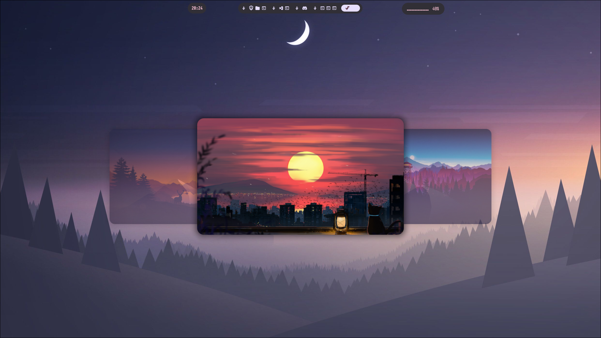
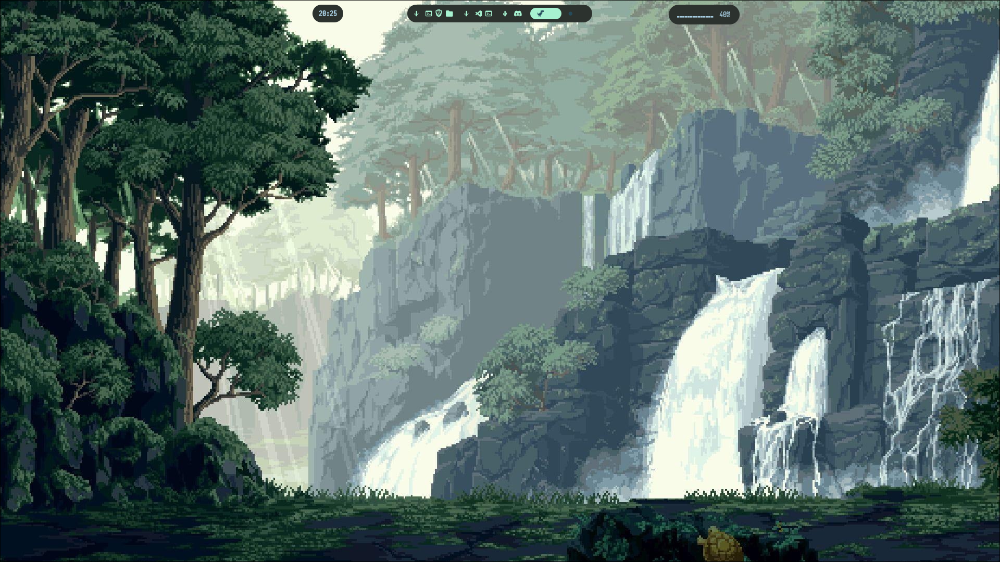
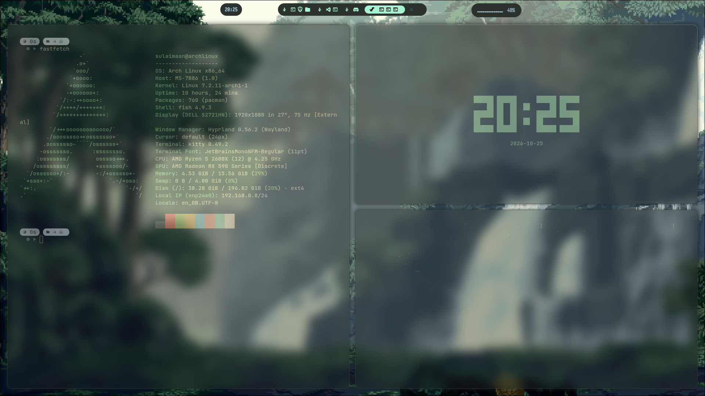
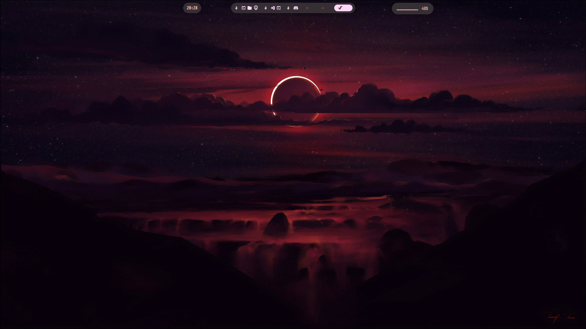
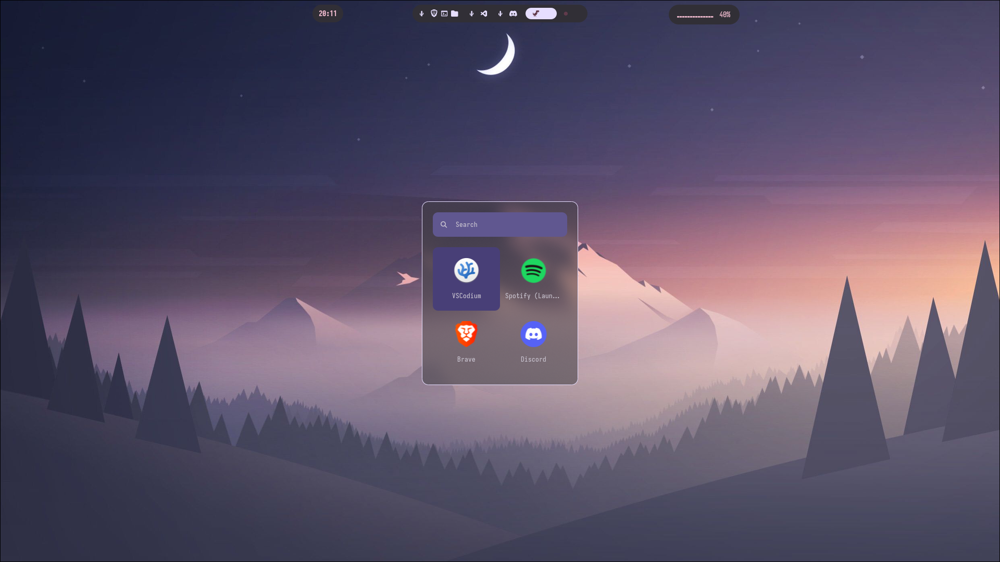
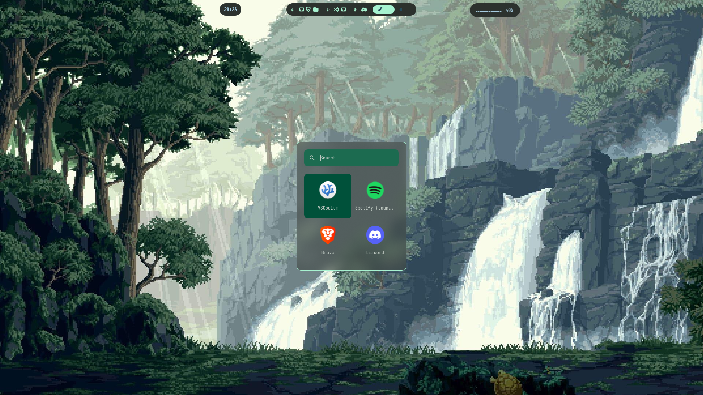
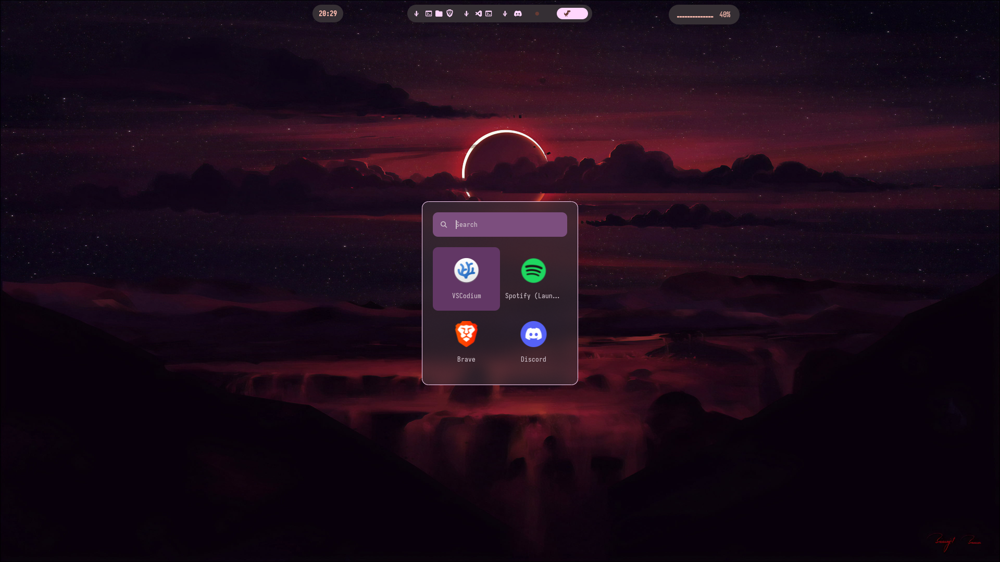

# **Custom dotfiles for work**

## Matuwall & Matugen

Click to expand

  
This features a wallpaper selector and automatic theme changer upon changing the background.
The colour themes are generated by Matugen, and the wallpaper selector is generated by Matuwall.

## Waybar

Click to expand

  

## Rofi

Click to expand

  

